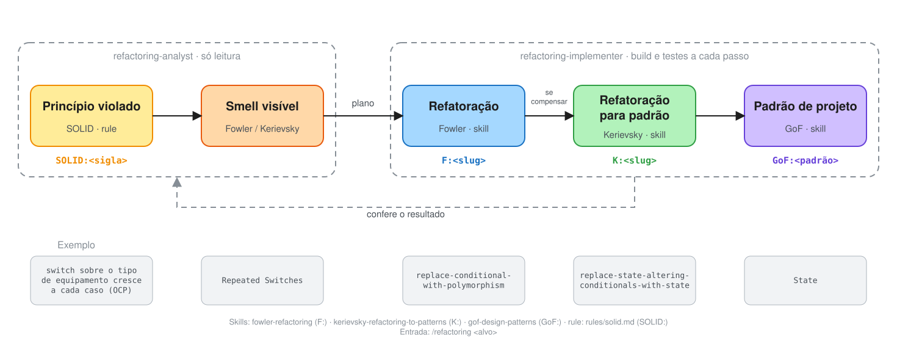

# refactoring-kit

The refactoring catalogs of Martin Fowler and Joshua Kerievsky and GoF design patterns, packaged
as [Agent Skills](https://agentskills.io) for coding agents (Claude Code and Codex). The package
also ships two subagents, two rules and a C# example in every refactoring and pattern file.

**Site:** <https://gabrieldulolmarques.github.io/refactoring-kit/> (English and Portuguese).

**Using it?** If these skills help you in a project, a paper or a post, please mention it: link
this repository and credit Gabriel R. Marques ([gabrieldulolmarques](https://github.com/gabrieldulolmarques)
on GitHub). I'd also like to hear how it went, so feel free to open an issue.

## What is in it

One skill per book, so you can tell which catalog each applied thing came from, plus an entry skill:

| Skill | Source | What it brings | ID |
|---|---|---|---|
| `refactoring` | | The entry point: `/refactoring <target>` (in Codex, `$refactoring <target>`; through the plugin, `$refactoring-kit:refactoring <target>`) diagnoses, picks the skill and applies step by step | |
| `fowler-refactoring` | Fowler (2018) | 24 code smells and 66 refactorings | `F:<slug>` |
| `kerievsky-refactoring-to-patterns` | Kerievsky (2004) | 12 code smells and 27 refactorings that take code to a pattern, towards it or away from it | `K:<slug>` |
| `gof-design-patterns` | Gamma et al. (1995) | Lookup for the 23 patterns, each linked to the refactorings that reach it, where there are any | `GoF:<pattern>` |

Each refactoring has when to use, step-by-step mechanics, a C# 9 example and a verification checklist.
Each pattern has intent, when it pays off, participants, an example and risks. Sources are cited by
chapter and entry name, never by page.

## How the pieces fit together

A violated SOLID principle points to a smell, the smell to a Fowler refactoring and, if it pays off, to
a Kerievsky refactoring that ends in a GoF pattern. The drawing is editable: open
[`docs/flow.excalidraw`](docs/flow.excalidraw) in [excalidraw.com](https://excalidraw.com).

## Agents and rules

- `refactoring-analyst` reads the code it is pointed at, names the smells and returns a short plan:
  where, which smell, which refactoring, whether tests cover it and the risk. It never edits.
- `refactoring-implementer` applies one item of the plan (or a named refactoring), following the
  mechanics with a build and a test run after each step. It makes one commit per refactoring, with the
  source ID at the end of the description, and never pushes. Build and test commands come from the call
  or from the project's own instructions, not from this package.
- `rules/solid.md` has the SOLID checks, with the path from each principle to the refactorings.
- `rules/source-ids.md` defines the `F:`, `K:`, `GoF:` and `SOLID:` IDs in commits, plans and reports,
  for example `♻️ refactor(billing): replace payment type switch with strategy [SOLID:OCP] [F:replace-conditional-with-polymorphism]`.
  With them, `git rev-list --count --grep='\[F:' HEAD` counts the use of each source.

Review the analyst's plan before handing an item to the implementer.

## Installation

- **Claude Code, as a plugin:** clone the repository (`git clone https://github.com/gabrieldulolmarques/refactoring-kit`)
  and run `claude --plugin-dir <path-to-the-clone>`. The skills and agents get
  the `refactoring-kit:` prefix, and the entry point is `/refactoring-kit:refactoring`.
- **Codex, as a plugin:** `codex plugin marketplace add gabrieldulolmarques/refactoring-kit` (or a local path), then
  `codex plugin add refactoring-kit@refactoring-kit`. The router only runs when called, and the plugin prefixes its name: use
  `$refactoring-kit:refactoring`. The subagents do not come with the plugin: copy `codex/agents/*.toml` into the
  project's `.codex/agents/` (or `~/.codex/agents/`). Codex gives a subagent no sandbox of its own:
  `refactoring_analyst` is told not to edit, but it uses the session's sandbox.
- **Any Agent Skills client:** link each folder in `skills/` into the project's skills folder
  (`.agents/skills/` for Codex, `.claude/skills/` for Claude Code). On Windows, use a junction
  (`New-Item -ItemType Junction`). Install the four side by side: Kerievsky's refactorings point to
  Fowler's.
- **Rules:** copy `rules/*.md` into `.claude/rules/` or reference them from `AGENTS.md`. Plugins and
  skills do not install rules.

Use one route per project, or Claude Code sees the skills twice.

## Layout

| Path | Content |
|---|---|
| `skills/` | The four skills. The `SKILL.md` of `refactoring` routes to the others; those of the two refactoring catalogs lead from the smell to the refactoring and its file; the GoF one indexes the patterns. `references/` has one file per entry |
| `agents/` | The two Claude Code subagents (`.md`) |
| `codex/agents/` | The same subagents in TOML, for Codex |
| `rules/` | `solid.md` and `source-ids.md` |
| `.claude-plugin/`, `.codex-plugin/`, `.agents/plugins/` | The plugin manifests and Codex's local marketplace |
| `docs/` | The diagram (`flow.svg` and `flow.excalidraw`) |
| `CATALOG.md` | The spec: the 66 + 27 refactorings, the 24 + 12 smells, the 23 patterns, the file format and the C# level |
| `LICENSE`, `NOTICE` | CC BY 4.0; credit to Fowler, Kerievsky, the GoF authors and Addison-Wesley, and what the license covers |

Only each skill's description stays in the agent's context. The body loads when the skill is used, and
each refactoring's file only when the agent opens it. In the Claude Code subagents, the `SKILL.md` of the three
catalog skills is preloaded.

## License and credit

[CC BY 4.0](LICENSE): free to share and adapt for any purpose, as long as you credit this
package **and** the books it is based on:

> Martin Fowler. *Refactoring: Improving the Design of Existing Code*. 2nd ed. Boston:
> Addison-Wesley (Pearson Education), 2018. ISBN 978-0-13-475759-9.
>
> Joshua Kerievsky. *Refactoring to Patterns*. Boston: Addison-Wesley (Pearson Education),
> 2004. ISBN 978-0-321-21335-8.
>
> Erich Gamma, Richard Helm, Ralph Johnson, John Vlissides. *Design Patterns: Elements of
> Reusable Object-Oriented Software*. Reading: Addison-Wesley, 1995. ISBN 978-0-201-63361-0.
>
> Robert C. Martin. *Agile Software Development: Principles, Patterns, and Practices*. Prentice Hall,
> 2002. ISBN 978-0-13-597444-5.
>
> Robert C. Martin. *Clean Architecture: A Craftsman's Guide to Software Structure and Design*. Pearson,
> 2017. ISBN 978-0-13-449416-6.

The license covers only this package's own content, not the books (see [NOTICE](NOTICE)).
The motivation and mechanics in the skills are paraphrased, with the chapter cited;
nothing is copied from the books, refactoring.com or industriallogic.com. Refactoring names, former
names and inverses come from the book's section headers, and from the book's web edition for the five web-only
refactorings. The C# examples are original.
